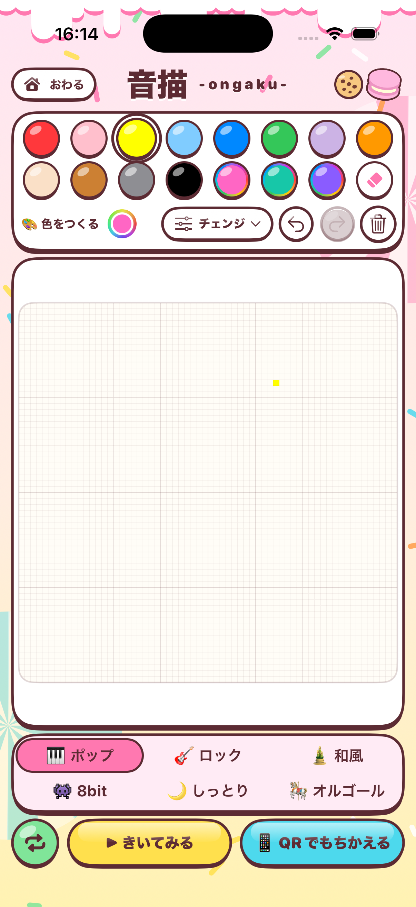
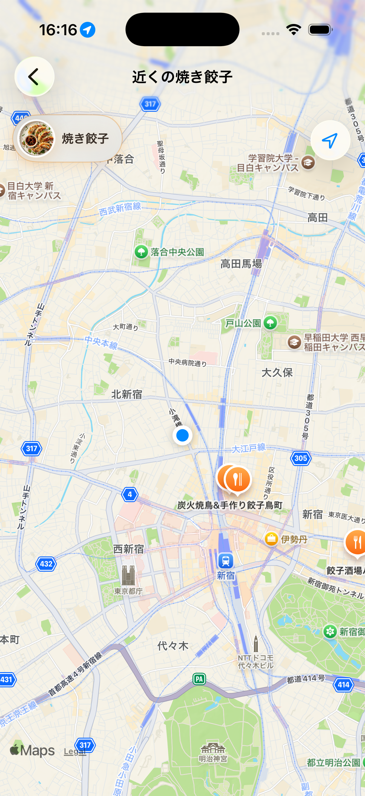
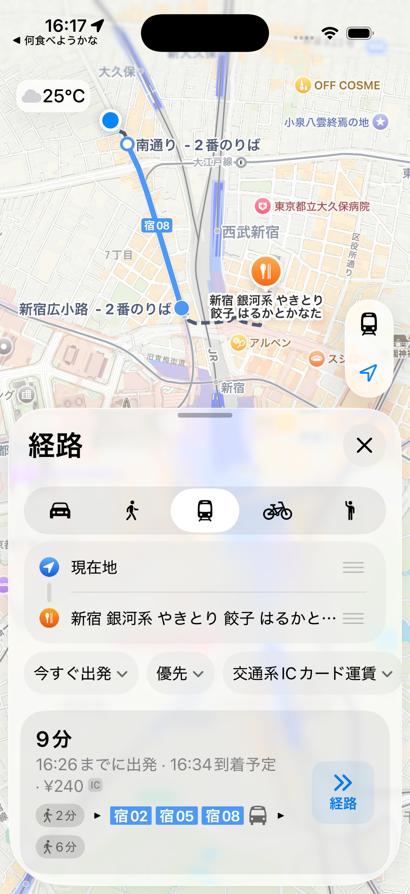
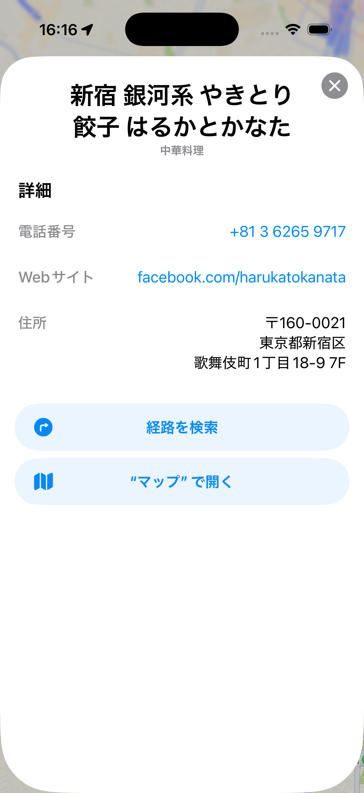

# 日専祭アプリ：（アプリ名をここに書く）

> **チーム：** チーム名：みつぼし　氏名：26cm0129古田裕稀、26cm0128封怡璇、26cm0139李安琪
> **AI利用レベル：** 2（生成コード可）
> **最終更新：** 2026/10/02

> 💡 制作の進め方は担任の先生から案内があります。このファイルの項目は、担任の先生の指示で増えることがあります。

---

## 何ができるアプリか（3行）

【音描-ongaku-】イラストを描く、絵を音に変換する、ダウンロードする
【なに食べるかな】気分を選択、スマホを振ってランダムで食べ物を表示(3km範囲のお店)、地図を表示

## 画面

## 使った文法・技術

（例：`@State`、`List`、`ForEach`、構造体、配列の `append` と `remove`）
CLLocationManager()
@Published
@StateObject
@State
MapCameraPosition
MKMapItem
Map(position: $position, selection: $selectedItem)
CLLocationCoordinate2D
MKLocalSearch

UIImpactFeedbackGenerator
NSDataAsset
AVAudioPlayer

NavigationStack 
RadialGradient
GeometryReader
Ellipse
gesture
ForEach
## 生成AIの使い方（どの場面で、どう使ったか）

（例：画面の骨組みは ChatGPT に書いてもらった。削除ボタンが効かなかったので、原因を質問して直した。）
食べ物を惑星、今日の気分をその周りを回る軌道のように表現したかったので、デザインや実装方法についてAIに相談しました
店舗をタップしたときに詳細情報を表示するため、mapItemDetailSelectionAccessory()の使い方についてAIに質問しました
画面をタップするときの効果音をつけるために、AIに相談し、AudioServicesPlaySystemSound(1104)を使う方法を教えてもらいました

## 展示で工夫した点

ユーザー体験を向上させるため、ランダムで選ばれる結果が前回と重複しないようにしました
